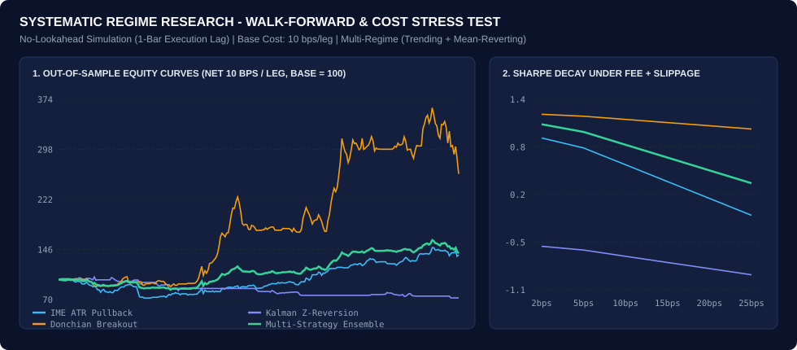

# Systematic Strategy Research, ATR Risk Sizing & Walk-Forward Validation (Freqtrade & Jesse)

**Abu Ishak** · B.Sc. (Honours) in Statistics, Jagannath University  
[](https://www.linkedin.com/in/abuishak/)
[](mailto:a6uishak@gmail.com)

---

## Executive Summary

Rather than deploying unvalidated black-box trading scripts, this repository demonstrates **institutional quantitative strategy engineering** across two open-source event-driven execution frameworks (**Freqtrade** and **Jesse**). It showcases five clean strategies spanning volatility pullbacks, Kalman Filter statistical mean-reversion, and regime-confirmed breakouts—benchmarked via a zero-lookahead **Walk-Forward Out-of-Sample & Transaction-Cost Stress Test**.

### Framework Architecture Comparison

| Capability | **Freqtrade (`IStrategy` v3)** | **Jesse (`Strategy`)** |
| :--- | :--- | :--- |
| **Execution Style** | Vectorized indicator DataFrame + bar/tick callbacks | Event-driven candle callbacks (`should_long`, `update_position`) |
| **Position Sizing** | `custom_stake_amount()` + `adjust_trade_position()` | Native equity-risk sizing (`utils.risk_to_qty(balance, risk_pct, ...)`) |
| **Dynamic Risk Guards** | `custom_stoploss()` + Portfolio `protections` (`MaxDrawdown`, `StoplossGuard`) | Intra-trade stop updates, multi-tranche `take_profit`, `liquidate()` |
| **Included Strategies** | `ImeAtrPullbackV6`, `KalmanZScoreReversion`, `VolatilityBreakoutRegime` | `JesseRegimeMomentum`, `JesseBollingerReversion` |

---

## Strategy Catalog (5 Research Implementations)

1. **`strategies/freqtrade/ime_atr_v6_pullback.py` (`ImeAtrPullbackV6`):**
   - Refactored institutional adaptation of custom live research strategy `imeatrv6.py` across liquid benchmark pairs (`BTC`, `ETH`, `SOL`, `AVAX`, `LINK`, `BNB`).
   - Combines short-horizon `ATR(3)` intrabar liquidity pullbacks gated by macro `EMA(30/40/60/90)` slope direction, conservative `max_leverage / 20` capping, ATR-based initial stops, **breakeven stop ratcheting at `+0.5x TP`**, **50% partial profit de-risking**, and holding-period timeouts.
2. **`strategies/freqtrade/kalman_zscore_reversion.py` (`KalmanZScoreReversion`):**
   - Tracks dynamic equilibrium price via a 1D scalar Kalman Filter and trades normalized spread extremes (`|Z| > 2.0`), strictly gated by `ADX < 25` to prevent mean-reversion entries during directional breakouts.
3. **`strategies/freqtrade/volatility_breakout_regime.py` (`VolatilityBreakoutRegime`):**
   - Captures 20-bar Donchian channel breakouts confirmed by `ADX > 25`, trailing exits via `ATR(14)` Chandelier stops alongside `CooldownPeriod`, `StoplossGuard`, and `MaxDrawdown (8%)` portfolio protections.
4. **`strategies/jesse/jesse_regime_momentum.py` (`JesseRegimeMomentum`):**
   - Uses a serial **Variance Ratio** ($VR_4 > 1.05$) persistence test + `EMA(21/55)` + `ADX > 22` in Jesse, enforcing strict **1.0% account equity risk per trade** (`utils.risk_to_qty`) and two-stage ATR profit taking.
5. **`strategies/jesse/jesse_bollinger_reversion.py` (`JesseBollingerReversion`):**
   - Multi-timeframe `4h EMA(200)` structural anchor paired with `15m` Bollinger Band (`2.2 sigma`) / RSI exhaustion entries, `0.75%` equity risk capping, and a 32-bar maximum holding-period time stop.

---

## Walk-Forward Out-of-Sample & Cost Stress-Test Results

Evaluated on a simulated multi-regime 4-hour return series with **strict 1-bar execution lag (zero lookahead)** across 1,800 post-warmup out-of-sample bars (`10 bps/leg` base fee + slippage):

| Strategy Archetype | OOS CAGR | Ann. Volatility | Sharpe Ratio (`10 bps`) | Max Drawdown | Sharpe at `2 bps` -> `25 bps` |
| :--- | :---: | :---: | :---: | :---: | :---: |
| **Donchian Breakout** | **+30.73%** | 26.08% | **1.16** | -28.26% | `1.23` -> `1.03` |
| **Multi-Strategy Ensemble** | **+9.81%** | **12.36%** | **0.82** | **-16.36%** | `1.09` -> `0.31` |
| **IME ATR Pullback (`v6`)** | +9.29% | 19.56% | 0.55 | -28.26% | `0.91` -> `-0.12` |
| **Kalman Z-Reversion** | -8.75% | 12.49% | -0.67 | -32.31% | `-0.54` -> `-0.92` |

**Key Research Findings:**
- **Diversification Benefit:** Blending pullback, mean-reversion, and breakout signals into the Multi-Strategy Ensemble reduces **Maximum Drawdown from `-28.26%` to `-16.36%`** (42% drawdown compression).
- **Transaction-Cost Fragility:** High-turnover `IME ATR Pullback` drops from `0.91` Sharpe (`2 bps`) to `-0.12` (`25 bps`), demonstrating why maker-limit order execution (`order_types: limit`) and fee stress testing are mandatory before deployment.



---

## Repository Structure & Reproduction

```text
systematic-regime-backtesting/
├── README.md
├── requirements.txt
├── configs/
│   └── freqtrade_research_config.example.json
├── research/
│   └── walk_forward_cost_stress_test.py
├── strategies/
│   ├── freqtrade/
│   │   ├── ime_atr_v6_pullback.py
│   │   ├── kalman_zscore_reversion.py
│   │   └── volatility_breakout_regime.py
│   └── jesse/
│       ├── jesse_regime_momentum.py
│       └── jesse_bollinger_reversion.py
└── assets/
    └── systematic_framework_comparison.svg
```

```bash
pip install numpy pandas
python research/walk_forward_cost_stress_test.py
```

---

## Limitations & Future Research
- **Mean-Reversion Regime Bleed:** `Kalman Z-Reversion` struggled (`-0.67` Sharpe) during rapid regime switches before the rolling trend-strength gate caught up; adding a Bayesian changepoint probability or wider entry `|Z| > 2.5` threshold is planned.
- **No Unverified Live PnL Claims:** All metrics above come exclusively from reproducible, deterministic simulation in `walk_forward_cost_stress_test.py`.

> *Disclaimer: Educational and quantitative research demonstration only; does not constitute financial advice or live return guarantees.*
